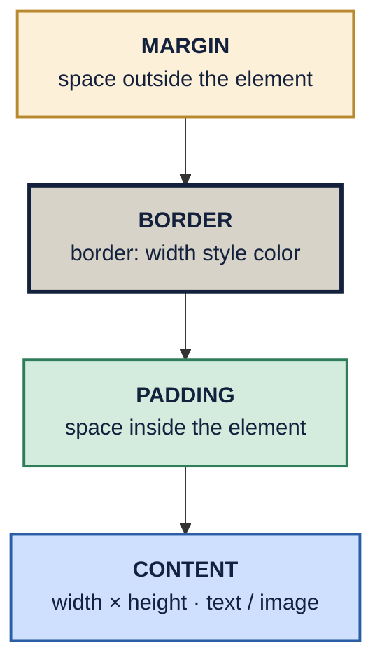

<div align="center">


Notes Session 8
<p>
  
  
  
  
  
</p>

<p>
  <a href="./Notes_Session_08.pdf"><b>📄 Open the PDF</b></a> &nbsp;•&nbsp;
  <a href="#-whats-inside"><b>📚 What's inside</b></a> &nbsp;•&nbsp;
  <a href="#-quick-cheat-sheet"><b>⚡ Cheat sheet</b></a> &nbsp;•&nbsp;
  <a href="#-author"><b>👤 Author</b></a>
</p>

</div>

---

<div dir="rtl" align="right">

## 🌟 نبذة عن المشروع

المشروع ده عبارة عن **ملاحظات السيشن الثامن في CSS** بعد ما اتكتبت من الصفر، واتبسطت واتنسقت بشكل مناسب للتسليم الأكاديمي.
كل خاصية (property) متشرحة بالعربي البسيط، مع **المصطلحات التقنية بالإنجليزي**، وجنبها:

- ✅ القيمة الافتراضية **(Default)**
- ✅ القيم المتاحة **(Values)**
- ✅ تستخدمها إمتى **(Use case)**
- ✅ أمثلة حيّة ورسومات توضيحية

</div>

---

## 📚 What's inside

<table>
<tr>
<th align="center">#</th>
<th align="left">Topic</th>
<th align="left">Key properties</th>
</tr>
<tr><td align="center">1</td><td><b>Text &amp; Font</b></td><td><code>text-decoration</code> · <code>font-size</code> · <code>font-weight</code> · <code>font-family</code> · <code>font-style</code></td></tr>
<tr><td align="center">2</td><td><b>Border</b></td><td><code>border-width</code> · <code>border-style</code> · <code>border-color</code> · <code>border</code></td></tr>
<tr><td align="center">3</td><td><b>Padding</b></td><td><code>padding</code> · <code>padding-top/right/bottom/left</code></td></tr>
<tr><td align="center">4</td><td><b>Margin &amp; Centering</b></td><td><code>margin</code> · <code>margin: auto</code> · <code>text-align: center</code></td></tr>
<tr><td align="center">5</td><td><b>Box Model</b></td><td>content → padding → border → margin</td></tr>
<tr><td align="center">6</td><td><b>Display</b></td><td><code>inline</code> · <code>inline-block</code> · <code>block</code></td></tr>
<tr><td align="center">7</td><td><b>Page Structure</b></td><td><code>&lt;header&gt;</code> · <code>&lt;nav&gt;</code> · class naming · <code>*</code> selector · <code>border-radius</code></td></tr>
<tr><td align="center">8</td><td><b>Shortcuts &amp; Font Families</b></td><td><code>serif</code> · <code>sans-serif</code> · <code>cursive</code> · browser shortcuts</td></tr>
<tr><td align="center">9</td><td><b>Quick Revision</b></td><td>جدول مراجعة سريع لكل الخصائص</td></tr>
</table>

---

## 🧊 The Box Model at a glance



---

## ⚡ Quick cheat sheet

<details open>
<summary><b>🎨 Text &amp; Font</b> — click to collapse</summary>

```css
h1 {
  font-family: 'Poppins', sans-serif; /* default: 'Times New Roman' */
  font-size: 32px;                    /* depends on the tag */
  font-weight: 700;                   /* 100 → 900, normal = 400 */
  font-style: italic;                 /* normal | italic */
  text-decoration: underline;         /* none | underline | line-through | overline */
}
```

</details>

<details>
<summary><b>🔲 Border</b></summary>

```css
.card {
  border: 3px solid #14213d;  /* width + style + color */
  border-radius: 12px;        /* rounded corners */
}
```

> ⚠️ If you write only `border: 15px;` the border **won't show**, because the default `border-style` is `none`. Always set the style.

</details>

<details>
<summary><b>📏 Padding &amp; Margin</b></summary>

```css
.box {
  padding: 10px 20px 30px 40px;  /* top right bottom left (clockwise) */
  margin: 0 auto;                /* centers a block element horizontally */
}
```

| | Padding | Margin |
|---|---|---|
| **Location** | Inside the border | Outside the border |
| **Separates** | Content ↔ border | Element ↔ other elements |
| **Background** | Takes the element's color | Transparent |

> 💡 `margin: auto` needs **`display: block`** and a **`width` smaller than 100%**.

</details>

<details>
<summary><b>🧱 Display</b></summary>

| Value | Sits in line? | `width` / `height` | `margin-top/bottom` |
|---|:---:|:---:|:---:|
| `inline` | ✅ | ❌ | ❌ |
| `inline-block` | ✅ | ✅ | ✅ |
| `block` | ❌ (full row) | ✅ | ✅ |

</details>

<details>
<summary><b>🏗️ Page structure &amp; reset</b></summary>

```html
<header class="header-home">
  <nav class="nav-home">
    <a href="">Home</a>
    <a href="">About</a>
    <a href="">Contact</a>
  </nav>
</header>
```

```css
* {
  margin: 0;
  padding: 0;
  box-sizing: border-box; /* padding + border stay inside the width */
}

.nav-home a {
  text-decoration: none;
  display: inline-block;
}
```

**Class naming rule:** `section-name` + `page-name` → `header-home`, `nav-home`, `header-home-content`.

</details>

<details>
<summary><b>⌨️ Browser shortcuts</b></summary>

| Shortcut | Action |
|---|---|
| `Ctrl` + `Shift` + `T` | Reopen the last closed tab |
| `Ctrl` + `Shift` + `B` | Show / hide the Bookmarks Bar |

</details>

---

## 🗂️ Project structure

```text
📦 notes-session-08
 ┣ 📄 Notes_Session_08.pdf   # the full notes (17 pages)
 ┗ 📄 README.md              # you are here
```

---

## 🚀 How to use

1. Open **[`Notes_Session_08.pdf`](./Notes_Session_08.pdf)** directly on GitHub, or press **Download** to keep a copy.
2. Use the **Quick Revision** table on the last pages before an exam or a quiz.
3. Try each live example in your own editor to see the difference.

---

## 🗺️ Series

| Session | Topics | Status |
|---|---|:---:|
| **Session 07** | `width` · `height` · `background` · text properties | ✅ |
| **Session 08** | Text & Font · Border · Padding · Margin · Display · Structure | ✅ |
| **Next** | Coming soon | ⏳ |

---

## 👤 Author

<div align="center">

### **أحمد خالد جابر**
**Ahmed Khaled Gaber**

Faculty of Computers and Information — Mansoura University


---

<div align="center">

⭐ لو الملف فادك، سيب نجمة للمشروع! &nbsp;|&nbsp; If this helped you, leave a star!


</div>
